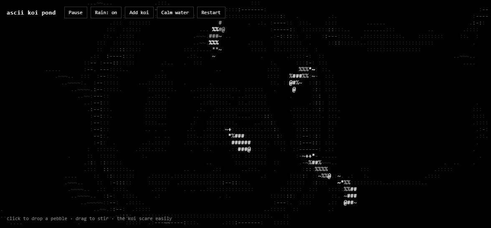

# ascii koi pond

An interactive koi pond drawn entirely in ASCII characters, in black and white. Drop pebbles, stir the water, and watch the koi scatter.

**Live demo:** https://mgzhrr.github.io/ascii-koi-pond/



One `index.html` file with HTML, CSS and vanilla JavaScript on a canvas. No frameworks, libraries or build step.

## Features

- Ripples that spread, bounce off the edges and cross each other
- Koi that wander, steer away from the edges and dart away from splashes
- Light rain that drops random pebbles (toggle on or off)
- Faint drifting glints on calm water
- Up to 12 koi, white with gray patches or the reverse
- Sharp text on high-DPI screens, and a full-screen layout that fits phones
- Starts paused with rain off when the system's reduced-motion setting is on

## Controls

| Action | What it does |
| --- | --- |
| Click or tap | Drops a pebble and scares nearby koi |
| Drag | Stirs the water and leaves a wake |
| **Pause / Resume** | Stops or continues the animation |
| **Rain** | Turns random raindrops on or off |
| **Add koi** | Adds a koi, up to 12 |
| **Calm water** | Clears all ripples |
| **Restart** | New koi and still water |

## How it works

**Water.** The pond is a grid of water heights updated 60 times a second with the 2D wave equation: each cell's next height is half the sum of its four neighbors minus its previous height, times a small damping factor so ripples fade. Each cell's height is drawn as a character from ` .:-~=+*#%@`, from faint to strong, with crests brighter than troughs. The simulation grid has two rows per text row, which keeps its cells about square, so ripples spread as circles even though characters are taller than they are wide.

**Koi.** Each koi is a chain of 11 points. The head wanders with a slowly changing turn rate and a side-to-side swimming wiggle, and every other point follows the one in front at a fixed distance, so the body bends naturally. The body is drawn wider in the middle, with fins and a tail that flap. When a pebble lands nearby, a koi turns away and gets a speed boost that fades. Each koi also leaves a faint wake in the water.

**Drawing.** Each frame builds the characters for every cell, then draws each row with one `fillText` call per gray level, which keeps it fast.

## Run locally

Download or clone the repo and open `index.html` in a browser.

```bash
git clone https://github.com/mgzhrr/ascii-koi-pond.git
```

To check the ripple maths, add `?selfcheck` to the page's address and look in the browser console for `selfcheck passed`.

## Known limits

- Resizing the window clears the ripples.
- The koi don't avoid each other, so they can swim through one another.
